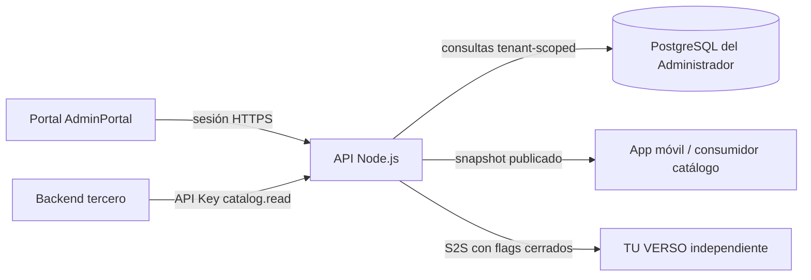

# Arquitectura del Administrador SaaS — INTEGRA B2G

## Actualización de arquitectura: gateway MOBILE_APP TEXT/FORM (22-11-2026)

**Contrato actual:** [API del Administrador y mapa de mantenimiento](ADMIN_MOBILE_APP_TEXT_FORM_API_20261122.md).
Android crea una interacción con `POST /api/v1/mobile/interactions` y luego
envía `POST /api/v1/mobile/interactions/{interactionId}/message`, indicando
explícitamente `type:"TEXT"` o `type:"FORM"`.
El backend `server/mobile-tuverso-routes.mjs` valida propiedad de
`appId`/`storeId`, UUID de acceso y de idempotencia, vínculo por tenant,
sesión no finalizada y estado remoto antes de pasar un mensaje a
`server/tuverso-mobile-connector.mjs`. Este módulo guarda el bearer en
servidor y llama al S2S de TU VERSO; no se usan cookies del portal en TU VERSO.

Un FORM puede venir con `form:{title,subtitle?,fields:[{variable,value}]}`
validado (1–5 filas) o como datos de pedido que el Administrador transforma
desde catálogo publicado. En ninguno de los dos casos el formulario es
autoridad para precio, inventario, pago o aceptación de pedido.
`TEXT` libre requiere clave UUID independiente y no admite filas FORM.
Los clientes legados sin `type` conservan pedido `TEXT`.
TU VERSO, exclusivamente en su canal MOBILE_APP, genera Aceptar/Rechazar y
produce mensaje de salida `aceptar` o `rechazar`. El Administrador entrega
solo `agentMessages[].text` verificados mediante su endpoint de seguimiento;
la decisión comercial ocurre en Android. El formulario no cambia WhatsApp,
no requiere migración nueva del Administrador ni un nuevo servicio.

**Estado:** código documentado desde la rama de desarrollo
`fix/b3-mobile-form-to-tuverso-20261122`, 43/43 pruebas focales aprobadas.
No se ha constatado aquí la instalación local del Administrador ni un E2E
Android→agente→Android. Los apartados fechados 20-11-2026 abajo son su
marco histórico, no una afirmación de que las rutas TEXT/FORM no existan.

**Repositorio:** `josmiguelv/Aplicacion-Web-Admin-Movil`  
**Corte de esta documentación:** 20-11-2026  
**Alcance:** portal administrativo, backend y APIs de este repositorio. No describe ni cambia el repositorio, base de datos o despliegue de TU VERSO.

## 1. Propósito y límites

El sistema es un administrador comercial multitenant de INTEGRA B2G. El software es propiedad de la plataforma; Pollos B3 u otra empresa se registra como tenant y no está codificada como tenant privilegiado. El frontend y las APIs viven en el mismo repositorio, y PostgreSQL conserva la configuración, las sesiones y el catálogo publicado.

El backend sirve dos grupos de capacidades: administración de empresas y datos comerciales; y lectura/operaciones acotadas para aplicaciones y servidores consumidores. La aplicación móvil puede consultar configuración pública publicada. Los secretos de servidor y las credenciales TU VERSO deben permanecer en backend.

La implementación actual tiene una frontera por tenant, aunque no todas las dimensiones son configurables aún: el catálogo publica `currency: PEN`, el huso horario tiene fallback `America/Lima`, y el contrato de disponibilidad está orientado a solicitudes de pedido. No presentar estas APIs como solución completa de pedidos, pagos, inventario o multimoneda.

## 2. Vista de componentes

`server/index.mjs` inicia el servidor HTTP, pool de PostgreSQL, validadores, rutas administrativas y públicas, publicación de catálogos y health checks. Extrae contratos específicos a `server/integrations.mjs`, `server/service-api-keys.mjs` y `server/mobile-order-availability.mjs`. El frontend Vite/React usa `src/app/AdminPortal.tsx` como entrada activa. `src/app/App.tsx` es un prototipo visual anterior y no es la autoridad de autenticación.

## 3. Perfiles, identidad y tenant

| Perfil | Capacidades | Frontera de datos |
| --- | --- | --- |
| `SUPER_ADMIN` | Administrar tenants, usuarios tenant y configuraciones globales/integraciones autorizadas | Plataforma; sigue sujeto a las rutas y validaciones del servidor |
| `TENANT_ADMIN` | Administrar recursos comerciales de su empresa | Tenant asociado al usuario en `admin_users.tenant_id` |
| Consumidor público móvil | Leer catálogo publicado y usar contratos públicos permitidos | Identificado por app registrada y activa; solo obtiene publicación correspondiente |
| Backend S2S externo | Leer catálogo con `catalog.read` | Tenant que emitió la API Key; `appId` debe corresponder al mismo tenant |

La cookie histórica `b3sid` es solo un nombre de sesión. No significa que exista un tenant B3 predeterminado. `tenantOf()` verifica el UUID, el rol y la empresa activa; las operaciones comerciales deben obtener el tenant de la sesión o credencial validada, no confiar en `tenantId` enviado por la interfaz.

**Límite de aislamiento:** el código aplica filtros/relaciones por tenant y algunas claves foráneas compuestas. PostgreSQL Row Level Security (RLS) no está configurado. Para cada cambio que agregue tablas o relaciones, mantener las consultas tenant-scoped, comprobar pertenencia de IDs foráneos y agregar cobertura con al menos dos tenants.

## 4. Flujos principales

### 4.1 Inicio de sesión y administración

1. `AdminPortal.tsx` llama a `POST /api/admin/login`.
2. El servidor verifica el usuario activo, compara el hash de contraseña y crea sesión con token aleatorio; guarda solo su hash en `admin_sessions`.
3. El navegador recibe cookie `HttpOnly`, `SameSite=Strict`; el backend valida sesión y rol en cada ruta administrativa.
4. El frontend carga identidad/tenants y abre el módulo autorizado. Las escrituras validan origen permitido y tenant antes del SQL.

En producción `ADMIN_ORIGIN` debe ser un origen HTTPS exacto y `DATABASE_URL` es obligatoria. CORS público y controles de sesión administrativa son caminos distintos; no mezclar encabezados/cookies al añadir una API.

### 4.2 Borrador y publicación del catálogo

1. La UI edita productos, sedes, horarios, tarifas, promociones, pagos, apps, vacantes y URL de reclamaciones bajo el tenant.
2. Backend valida entrada y persiste configuración editable en tablas base.
3. `publish()` reúne solo datos activos del tenant/app, genera una revisión y guarda el snapshot en `published_catalogs`.
4. Lectores móviles reciben el snapshot publicado. Editar un borrador no cambia lo que ve el consumidor hasta publicar otra revisión.

Al añadir un campo visible a un consumidor, seguir todo el camino UI → validación servidor → SQL/migración → `publish()` → DTO/contrato → endpoint de lectura. Un tipo frontend por sí solo no valida ni persiste el dato.

### 4.3 Cotización de fulfillment

`POST /api/v1/mobile/fulfillment/resolve` evalúa modo de entrega/retiro con datos publicados y configuración de sede. Google Routes, cuando corresponde, se invoca desde el backend. La clave de Google no debe estar en APK, navegador o `VITE_*`. Cobertura y precio son reglas distintas; confirmar semántica en el código y contrato antes de alterar cálculo.

### 4.4 Disponibilidad del pedido y TU VERSO

La API `POST /api/v1/mobile/orders/availability` crea/consulta una validación idempotente basada en el catálogo y sede. El flujo puede solicitar revisión de disponibilidad/interacción a TU VERSO por conexión server-to-server configurada para la misma empresa y app. `GET /api/v1/mobile/orders/availability/{validationId}` lee el estado con token de validación. El contrato actual no crea pedido comercial, no cobra, no reserva inventario y no confirma pago; `READY_FOR_PAYMENT` expresa aceptación de disponibilidad dentro del flujo.

Las credenciales de integración se cifran en backend con AES-256-GCM (`server/integration-crypto.mjs`). Los flags `TUVERSO_LIVE_CHECKS_ENABLED` y `TUVERSO_LIVE_REQUESTS_ENABLED` mantienen llamadas reales desactivadas por defecto. Pruebas con dependencias simuladas no equivalen a E2E ni certifican una cuenta productiva.

## 5. APIs por audiencia

| Grupo | Rutas conocidas | Autorización y propósito |
| --- | --- | --- |
| Portal | `/api/admin/*` | Cookie de sesión; roles de plataforma/tenant; gestión y persistencia |
| Catálogo móvil | `GET /api/v1/mobile/config`, `/fulfillment/resolve`, `/images/{id}` | Lectura pública de datos activos/publicados y consulta de sede/entrega |
| API Key S2S | `GET /api/v1/integrations/catalog` | `Authorization: Bearer ib2g_sk_v1_…`; scope `catalog.read`; tenant desde hash de clave |
| Disponibilidad | `POST /api/v1/mobile/orders/availability`, `GET .../{validationId}` | App registrada, idempotencia/token opaco; estado de validación |
| Salud | `/health/live`, `/health/ready` | Liveness del proceso y readiness con PostgreSQL |

Los contratos y ejemplos vigentes se mantienen en [API Keys](API_KEYS_INTEGRACIONES.md), [Disponibilidad de pedidos](MOBILE_ORDER_AVAILABILITY_API.md) y [Integración TU VERSO](TUVERSO_INTEGRACIONES.md). Confirmar rutas y payload desde el código antes de publicar una API nueva; la lista es una guía de navegación, no reemplaza OpenAPI.

## 6. Datos principales

| Dominio | Tablas |
| --- | --- |
| Empresas y acceso | `tenants`, `admin_users`, `admin_sessions`, `admin_audit` |
| Catálogo y apps | `mobile_apps`, `stores`, `products`, `promotions`, `payment_methods`, `product_images`, `job_vacancies`, `published_catalogs` |
| Integraciones | `tenant_integrations`, `integration_bindings` |
| Acceso S2S | `tenant_api_keys` |
| Disponibilidad | `mobile_order_validations`, `mobile_order_attempts` |

`server/schema.sql` es el esquema integral para una base vacía e incluye DDL de evolución histórica. No es un script de actualización para una base con datos. En entornos existentes se aplica exclusivamente la migración que corresponda y después de confirmar base, estado e historial.

| Migración | Área |
| --- | --- |
| `003-tuverso-integrations.sql` | Credenciales e integración por tenant, vínculos con sedes |
| `004-minimal-tuverso-configuration.sql` | Permite configuración incompleta de metadatos externos |
| `005-tenant-api-keys.sql` | Claves S2S por tenant para lectura de catálogo |
| `006-mobile-order-availability.sql` | Disponibilidad, asociación app/vínculo, idempotencia y zona horaria |

Las migraciones no se ejecutan automáticamente al iniciar la API. Son exclusivamente para la base del Administrador; no deben ejecutarse en TU VERSO.

## 7. Secretos e integraciones

- `ib2g_sk_v1_…` son API Keys del Administrador; solo se guarda su SHA-256 y se muestran una vez al emitirlas.
- `tvi_v1_…` son credenciales TU VERSO; cifradas por el Administrador cuando están configuradas.
- `GOOGLE_ROUTES_API_KEY` pertenece al backend y solo habilita uso de Google Routes según configuración.
- No poner secretos en repositorio, APK, JavaScript descargado, URL, logs ni documentación de ejemplo con valores reales.
- El tenant de una llamada S2S debe derivarse de una credencial o vínculo validado, nunca de un campo libre confiado.

## 8. Estado y limitaciones documentadas

- Rama de trabajo revisada: `feat/multitenant-mobile-order-availability`. Que una capacidad exista en esta rama no prueba que esté desplegada.
- La API de disponibilidad tiene pruebas focalizadas registradas para su lógica, pero la migración 006 y la ejecución local/E2E deben confirmarse aparte.
- No hay evidencia en esta documentación de una app móvil consumiendo en vivo, pedido real, cobro, reserva de inventario o integración productiva E2E.
- La moneda del catálogo es `PEN`; el huso horario usa configuración de tenant con fallback `America/Lima`.
- Algunos limitadores son en memoria por proceso; no son cuotas distribuidas entre réplicas.
- `server/index.mjs` concentra muchas rutas y reglas, lo que aumenta el riesgo de efectos laterales al editarlo.
- El frontend `src/app/App.tsx` es prototipo legado; el portal autenticado parte de `AdminPortal.tsx`.

## 9. Secuencia de análisis para una nueva funcionalidad

1. Precisar consumidor, tenant, rol, datos y resultado observable; separar administradores, apps y backends terceros.
2. Seguir el flujo actual desde pantalla/endpoint hasta función, tabla, snapshot y consumidor.
3. Determinar si se cambia contrato existente o se añade uno; preservar compatibilidad de revisiones y clientes.
4. Diseñar validación de servidor, ownership tenant, autorización, idempotencia y errores antes de editar UI.
5. Para persistencia, escribir una migración aditiva, tenant-scoped, revisable y segura de reintentar cuando aplique.
6. Añadir solo pruebas focalizadas al camino modificado; incluir tenants distintos ante cualquier cambio de aislamiento.
7. Actualizar contrato, mapa de componentes, variables, operación local y estado de despliegue. Indicar por separado implementado, migrado, desplegado y certificado E2E.

## 10. Lectura relacionada

- [Mapa de componentes y riesgos](MAPA_COMPONENTES_Y_RIESGOS.md)
- [API Keys privadas](API_KEYS_INTEGRACIONES.md)
- [Integraciones TU VERSO](TUVERSO_INTEGRACIONES.md)
- [API de disponibilidad de pedidos](MOBILE_ORDER_AVAILABILITY_API.md)
